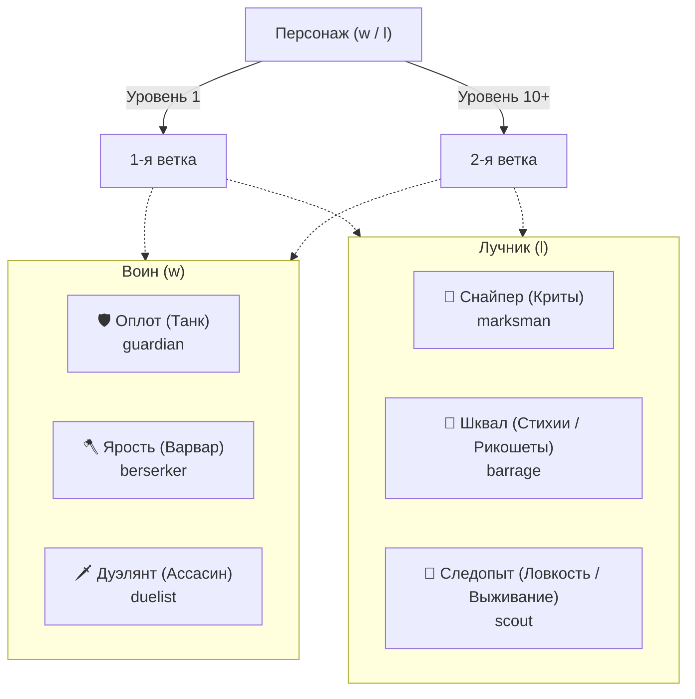

# Боевые умения и навыки: Воин и Лучник

Документация активных умений (`skills`), мастерства оружия (`weaponMastery`) и пассивных боевых талантов (`passiveSkills`) для физических классов — **Воина (`w`)** и **Лучника (`l`)**.

> Связанные документы:
> - [`docs/agents/magic-system.md`](magic-system.md) — Магическая система (Маг и Жрец)
> - [`docs/specs/magic-branches-plan.md`](../specs/magic-branches-plan.md) — Система веток специализации магий
> - [`docs/agents/subclasses.md`](subclasses.md) — 16 комбинаций подклассов улучшения класса и их навыки

---

## 1. Архитектура и компоненты

| Компонент / Слой | Путь | Назначение |
|---|---|---|
| Конструктор активных умений | `server/arena/Constuructors/SkillConstructor.ts` | Базовый класс активных умений с расходом энергии (`en`) |
| Конструктор пассивных навыков | `server/arena/Constuructors/PassiveSkillConstructor.ts` | Базовый класс пассивок, реагирующих на триггеры хуков эффектов |
| Активные умения | `server/arena/skills/` | Реализации: `parry`, `shieldBlock`, `dodge`, `disarm`, `berserk`, `shakeUp` («Встряска»), `aimedShot`, `piercingShot`, `cripplingShot`, `doubleShot`, `fireArrow`, `poisonArrow`, `step`, `help`, `beastCall`, `terrifyingHowl` |
| Мастерство оружия | `server/arena/weaponMastery/` | 6 типов владения оружием: `thrust`, `cut`, `chop`, `range`, `stun`, `healing` |
| Пассивные навыки | `server/arena/passiveSkills/` | Боевые таланты: `huntersMark`, `eagleEye`, `momentum`, `fieldMedic`, `survivalInstinct`, `ricochet`, `lacerate`, `sweepingBlow`, `consussion`, `weightyArgument` («Веский аргумент»), `nineLives` и др. |
| Сервис умений | `server/arena/SkillService.ts` | Изучение и валидация активных скиллов (`learnSkill`, `getSkillListByProf`) |
| Сервис пассивок | `server/arena/PassiveSkillService.ts` | Изучение пассивных умений и оружейного мастерства (`learnPassiveSkill`) |
| HTTP API | `server/server/skill.ts` | Эндпоинты `/skill/available`, `/skill/:id` |
| Клиентский UI | `client/src/routes/(app)/character/skills/`<br>`client/src/routes/(app)/character/passiveSkills/` | Экраны прокачки активных и пассивных умений за бонусы 💡 |

---

## 2. Сравнительный анализ: Классическая FWO vs fwo-tg

### 2.1. Активные классовые умения

| Умение | Код | Классы и уровень в FWO | Статус в fwo-tg | Реализация в коде | Отличия и состояние |
|---|---|---|---|---|---|
| **Парирование** (`parry`) | `pa` | Воин (ур. 1) | ✅ **Реализовано** | `server/arena/skills/parry.ts` | 6 уровней прокачки (`bonusCost: [10, 20, 30, 40, 60, 80]`). Снижает урон на `dex * effect`, при остатке > 0 полностью парирует атаку оружием ближнего боя. |
| **Блок щитом** (`shieldBlock`) | `sh` | Воин (ур. 2), Маг/Жрец (ур. 5), Лучник (ур. 6) | ⚠️ **Частично** (только Воин) | `server/arena/skills/shieldBlock.ts` | В коде `profList: { w: 4 }` (доступно Воину с 4 ур.). Требует щит в `offHand`. Поглощает удары емкостью блока и временно повышает магзащиту. |
| **Увёртка** (`dodge`) | `do` | Лучник (ур. 2) | ✅ **Реализовано** | `server/arena/skills/dodge.ts` | `profList: { l: 2 }`. 6 уровней прокачки. Шанс полного уворота от атак колющим, режущим, рубящим, метательным, оглушающим оружием на основе ловкости. |
| **Обезоруживание** (`disarm`) | `di` | Воин (ур. 3), Лучник (ур. 5) | ✅ **Реализовано** | `server/arena/skills/disarm.ts` | `profList: { w: 3, l: 5 }`. 6 уровней. Сравнивает ловкость инициатора и цели. При успехе цель теряет возможность бить оружием в раунде. |
| **Берсерк** (`berserk`) | `be` | Воин (ур. 5) | ✅ **Реализовано** | `server/arena/skills/berserk.ts` | В коде `profList: { w: 4 }`. Увеличивает максимальный урон (`hit.max * effect`), но срезает атаку и магзащиту (`1/effect`). |
| **Броня** (`armor`) | `pt` | Воин (ур. 5) | ❌ **Не реализовано** | — | В коде есть общее действие союзной защиты `protect` (`actions/protect.ts`), но нет отдельного классового скилла воина на селф-броню. |
| **Спасение** (`help`) | `he` | Лучник (ур. 6), Воин (ур. 3) | ✅ **Реализовано** | `server/arena/skills/help.ts` | `profList: { w: 3, l: 6 }`. На союзника (`OrderType.TeamExceptSelf`). Перенаправляет все физические атаки на спасателя до конца раунда, без счётчика зарядов; [цепочки и циклы](effects-system.md#перенаправление-цели-и-ограничения) обходятся с учётом выполненных экземпляров эффектов за попадание. |
| **Наложение рук** (`cure`) | `cu` | Лучник (ур. 7) | ⚠️ **Базовое действие** | `server/arena/actions/handsHeal.ts` | В коде реализовано как `handsHeal` («Лечение руками»), базовое действие 0 уровня. |
| **Подножка** (`step`) | `st` | Лучник (ур. 8) | ✅ **Реализовано** | `server/arena/skills/step.ts` | `profList: { l: 3 }`. 6 уровней (`levels: [0.6, 0.55, 0.5, 0.45, 0.4, 0.35]`). На цель (`OrderType.Enemy`). Срезает Защиту (`wpr * level`) на 40–65% и Атаку (`wat * (level + 0.2)`) на 20–45% в текущем раунде. Расход: 8–13 EN. |
| **Прицельный выстрел** (`aimedShot`) | `as` | Лучник | ✅ **Реализовано** | `server/arena/skills/aimedShot.ts` | `profList: { l: 2 }`. Селф-бафф (`OrderType.Self`): усиливает урон (`x1.25..x1.5`), игнорирует увёртку цели (`dodge`) через хук `onCastFail`, гарантируя попадание (не снимая увёртку для других атакующих). Расход: 10–14 EN, proc: 20%. |
| **Бронебойный выстрел** (`piercingShot`) | `ps` | Лучник | ✅ **Реализовано** | `server/arena/skills/piercingShot.ts` | `profList: { l: 3 }`. Селф-бафф (`OrderType.Self`): пробивает блок щитом (`shieldBlock`), игнорирует 40–80% брони цели (`phys.defence`). Расход: 12–16 EN. |
| **Выстрел в колено** (`cripplingShot`) | `cs` | Лучник | ✅ **Реализовано** | `server/arena/skills/cripplingShot.ts` | `profList: { l: 2 }`. Селф-бафф (`OrderType.Self`): сбивает увёртку, снижает ловкость цели на 25–45% и блокирует уклонение на 2 раунда (*«Когда-то и меня вела дорога приключений...»*). Расход: 12–16 EN. |
| **Залп стрел** (`doubleShot`) | `ds` | Лучник | ✅ **Реализовано** | `server/arena/skills/doubleShot.ts` | `profList: { l: 2 }`. Селф-бафф (`OrderType.Self`): при выстреле лучник выпускает дополнительную стрелу во вторую цель (или ту же) на 60–90% урона. Расход: 12–16 EN, proc: 30%. |
| **Зажигательная стрела** (`fireArrow`) | `fa` | Лучник | ✅ **Реализовано** | `server/arena/skills/fireArrow.ts` | `profList: { l: 3 }`. Селф-бафф (`OrderType.Self`): добавляет урон огнем к выстрелу (+10..20) и накладывает горение `burning` (фиксированные `1d3` урона огнем) на 2 раунда. Расход: 12–16 EN. |
| **Отравленная стрела** (`poisonArrow`) | `pa` | Лучник | ✅ **Реализовано** | `server/arena/skills/poisonArrow.ts` | `profList: { l: 3 }`. Селф-бафф (`OrderType.Self`): добавляет урон ядом к выстрелу (+10..20) и накладывает отравление `poison` (фиксированные `1d3` урона ядом) на 2 раунда. Расход: 12–16 EN. |

---

### 2.2. Мастерство оружия (Weapon Mastery)

Все 6 типов оружия из классики FWO **полностью реализованы** в папке `server/arena/weaponMastery/`. Их боевые эффекты и сохранённые уровни продолжают работать, но записи скрыты из списка `GET /passiveSkill` (в том числе при запросе через `ids`) и экрана изучения. Прямой `GET /passiveSkill/:id` и существующий `POST /passiveSkill/:id` пока не изменены.

Каждый навык имеет **6 уровней прокачки** со стоимостью:
`bonusCost: [30, 60, 90, 120, 150, 180]` (суммарно 630 бонусов).

**TODO:** Перенести отображение мастерства оружия в отдельный информационный раздел постоянных эффектов, без кнопок изучения за бонусы в текущем UI. Переработать получение уровней мастерства: прогресс должен начисляться за использование соответствующего типа оружия, а не за покупку за бонусы. Эта механика автопрогресса **ещё не реализована**; прямой endpoint изучения пока сохраняет прежнее поведение.

| Навык | Файл | Тип оружия | Эффект по уровням (1–6) | Механика в бою |
|---|---|---|---|---|
| **Колющее** (`thrustWeapon`) | `thrustWeapon.ts` | `thrust` (шпаги, копья) | Шанс: `[55, 60, 65, 70, 75, 80]%`<br>Эффект: `[3, 6, 9, 12, 15, 18]` | Снижает шанс уворота (`dodge`) и промаха (`miss`) противника. |
| **Режущее** (`cutWeapon`) | `cutWeapon.ts` | `cut` (мечи, кинжалы) | Шанс: `[5, 10, 15, 20, 25, 30]%`<br>Эффект: `[3, 6, 9, 12, 15, 18]` | Повышает шанс пробития защиты (`protect`). |
| **Рубящее** (`chopWeapon`) | `chopWeapon.ts` | `chop` (топоры, секиры) | Шанс: `[5, 10, 15, 20, 25, 30]%`<br>Эффект: `+3, +6, +9, +12, +15, +18` | Напрямую увеличивает наносимый физический урон при атаке. |
| **Дальнобойное** (`rangeWeapon`) | `rangeWeapon.ts` | `range` (луки, арбалеты) | Шанс: `[55, 60, 65, 70, 75, 80]%`<br>Эффект: `[3, 6, 9, 12, 15, 18]` | Снижает вероятность промаха (`miss`) и уворота (`dodge`) цели от выстрела. |
| **Оглушающее** (`stunWeapon`) | `stunWeapon.ts` | `stun` (молоты, булавы, дубины) | Шанс: `[5, 10, 15, 20, 25, 30]%`<br>Эффект: `[3, 6, 9, 12, 15, 18]` | Повышает шанс пробития вражеской защиты (`protect`). |
| **Лечащее** (`healingWeapon`) | `healingWeapon.ts` | `heal` (лечебные посохи) | Шанс: `[5, 10, 15, 20, 25, 30]%`<br>Эффект: `+3, +6, +9, +12, +15, +18` | Повышает лечебный эффект оружия при ударе/исцелении. |

---

### 2.3. Боевые пассивные таланты (Passive Skills)

В `fwo-tg` создана система оружейных и классовых пассивок (`server/arena/passiveSkills/`), активирующихся через событийные хуки движка боя:

Для «Рикошета» и «Размашистого удара» ниже указан согласованный целевой баланс; обновление документа не означает, что эти значения уже перенесены в код.

Вторичные попадания «Рикошета» и «Размашистого удара» не вызывают новых срабатываний этих пассивок и не запускают цепочку.

| Пассивка | Файл | Привязка | Шанс / Эффект | Описание механики |
|---|---|---|---|---|
| **🎯 Метка охотника** (`huntersMark`) | `huntersMark.ts` | Дальнобойное оружие (`range`) | Шанс: `[33, 50, 75]%`<br>Урон: `+10%, +20%, +30%` | При успешном выстреле вешает на цель метку на 2 хода. Следующая атака по цели наносит увеличенный урон (`markedShot`). |
| **🦅 Орлиный глаз** (`eagleEye`) | `eagleEye.ts` | Дальнобойное оружие (`range`) | Шанс: `[60, 75, 90]%` | Замена мастерства оружия: снижает шанс промаха (`miss`) при стрельбе из лука или арбалета. |
| **⚡ Кураж** (`momentum`) | `momentum.ts` | Дальнобойное оружие (`range`) | Энергия: `+2, +3, +5`<br>Урон: `+5%` за стак | Заменил `secondAttack`. Каждое попадание восстанавливает энергию и дает стак куража (до 3 стаков, +5% физ. урона каждый). |
| **💚 Полевой медик** (`fieldMedic`) | `fieldMedic.ts` | Выживание / Следопыт | Хил: `+30%, +45%, +60%`<br>Анти-срыв: `100%` | Заменил `smokeScreen`. Усиливает «Лечение руками» на 30–60% и полностью предотвращает срыв лечения вражескими физ. атаками. |
| **🛡️ Инстинкт выживания** (`survivalInstinct`) | `survivalInstinct.ts` | Выживание | Снижение: `[20, 30, 40]%` | При падении здоровья ниже 35% весь получаемый урон снижается на указанный процент. |
| **🔀 Рикошет** (`ricochet`) | `ricochet.ts` | Дальнобойное оружие (`range`) | Шанс: `[10, 15, 20]%`<br>Урон: `15%, 20%, 25%` | При выстреле стрела с указанной вероятностью отскакивает в одну случайную дополнительную вражескую цель, нанося указанный процент урона основной атаки. |
| **🩸 Рассечение** (`lacerate`) | `lacerate.ts` | Режущее оружие (`cut`) | Шанс: `[15, 20, 30]%` | При физ. атаке накладывает на цель длительный эффект `bleeding` (DoT-кровотечение). |
| **💥 Размашистый удар** (`sweepingBlow`) | `sweepingBlow.ts` | Рубящее оружие (`chop`, топоры/секиры) | Шанс: `[10, 15, 20]%`<br>Урон: `15%, 20%, 25%` | При ударе по цели с указанной вероятностью наносит указанный процент урона основной атаки одной случайной дополнительной вражеской цели (клив/сплеш-атака). |
| **Сотрясение** (`consussion`) | `consussion.ts` | Дробящее оружие (`stun`) | Шанс: `[10, 15, 25]%` | При атаке оглушает цель эффектом `stun`, блокируя её следующее действие в раунде. |
| **Веский аргумент** (`weightyArgument`) | `weightyArgument.ts` | Оплот (`guardian`), дробящее оружие (`stun`) | Шанс: `[10, 15, 20]%`<br>Снижение атак: `[10, 20, 25]%` | **Реализовано.** Физическое попадание, включая сплеш, с положительным фактически нанесённым уроном накладывает на фактическую цель эффект «Контузия» (`concussion`) на 2 раунда, включая текущий, только если его ещё нет. Снижает `phys.attack` и `magic.attack`, не оглушает. |
| **🐱 Девять жизней** (`nineLives`) | `nineLives.ts` | Пассивное выживание | Шанс: `[10, 20, 33]%` | 1 раз за бой при получении смертельного урона оставляет персонажу `0.05 HP`. |
| **🔔 Целебный боньк** (`healBonk`) | `healBonk.ts` | Лечащее оружие (`heal`) | Шанс: `[50, 75, 100]%`<br>Хил: `50%, 100%, 200%` | Удар посохом исцеляет случайного союзника на процент от нанесенного урона. |
| **Статичная защита** (`staticProtect`) | `staticProtect.ts` | Броня | Расчет от `attack / static.defence` | Пассивный шанс заблокировать атаку без заказа действия защиты. |
| **Промах судьбы** (`fatesMiss`) | `fatesMiss.ts` | Базовая механика | Шанс: `5%` | Случайный срыв физ. атаки по воле судьбы. |

`fatesMiss` и `divineWill` (базовый эффект магической системы) также скрыты из списка `GET /passiveSkill`, но остаются в боевой механике; прямой доступ по ID и сохранённые уровни не изменены. **TODO:** показывать эти постоянные игровые эффекты в информационном разделе, отдельно от изучаемых за бонусы пассивок, без управления ими в текущем UI.

---

### 2.4. Таланты из FWO, ожидающие реализации

1. **Второе оружие (`2nd_weapon`, Воин)**:
   - В FWO даёт шанс дополнительного бонуса к атаке одноручным оружием (дуал-вилд).
2. **Сила воли (`power`, Все классы)**:
   - Позволяет наносить удары даже при активном заклинании жреца «Затмение».
3. **Регенерации (`hp_regen`, `en_regen`)**:
   - Пассивная прокачка постоянного восполнения HP и энергии каждый раунд.
4. **Ремесло (`blacksmith`, `creator`)**:
   - Кузнечное дело (ковка экипировки и слитков).

---

## 3. Детальный разбор активных умений

### 3.1. Парирование (`parry`)
- **Класс**: Воин (`w: 1`).
- **Порядок в раунде**: Стадия `parry` (выполняется до атаки).
- **Стоимость энергии**: `[8, 9, 10, 11, 12, 13] EN`.
- **Шанс успеха**: `[70, 75, 80, 85, 90, 95]%`.
- **Множитель ловкости (`effect`)**: `[1.1, 1.2, 1.3, 1.4, 1.5, 1.6]`.
- **Формула**:
  ```typescript
  value = initiator.dex * effect;
  // При получении физ. урона холодным оружием (thrust, cut, chop, stun):
  affect.value -= enemy.dex;
  if (affect.value > 0) {
    // Удар успешно парирован! Атака противника прерывается CastError
  }
  ```

### 3.2. Блок щитом (`shieldBlock`)
- **Класс**: Воин (`w: 4`).
- **Требование**: Экипированный щит в слоте `offHand`.
- **Стоимость энергии**: `[8, 9, 10, 11, 12, 13] EN`.
- **Емкость блока**:
  ```typescript
  shieldCapacity = (0.3 * str + 0.7 * con + 0.25 * shield.defence) * effect;
  ```
- **Особенности**:
  - Пока действует щит, персонаж получает бонус к **магической защите** (`magic.defence += shieldCapacity`).
  - Каждый удар врага истощает прочность блока на `(0.7 * enemy.str + 0.3 * enemy.con) * proc`.
  - Если емкость блока исчерпана — блок спадает.

### 3.3. Увёртка (`dodge`)
- **Класс**: Лучник (`l: 2`).
- **Стоимость энергии**: `[10, 12, 14, 16, 18, 20] EN`.
- **Шанс применения**: `[75, 80, 85, 90, 95, 99]%`.
- **Формула шанса уворота от атаки**:
  ```typescript
  dodgeValue = effect * initiator.dex;
  dodgeFactor = Math.round(dodgeValue / enemy.dex);
  chance = Math.round(Math.sqrt(dodgeFactor) + 10 * dodgeFactor + 5);
  // При chance > d100 атака противника срывается!
  ```
- Защищает от любого оружия, кроме безоружного и специфической магии.

### 3.4. Обезоруживание (`disarm`)
- **Классы**: Воин (`w: 3`), Лучник (`l: 5`).
- **Тип заказа**: `OrderType.Enemy` (направлено на конкретного противника).
- **Стоимость энергии**: `[12, 13, 14, 15, 16, 17] EN`.
- **Формула успеха**:
  ```typescript
  if (initiator.dex * effect >= target.dex) {
    // Цель обезоружена: ее физ. атака оружием в этом раунде отменяется
  }
  ```

### 3.5. Берсерк (`berserk`)
- **Класс**: Воин (`w: 4`).
- **Стоимость энергии**: `[8, 9, 10, 11, 12, 13] EN`.
- **Эффект множителя**: `[1.1, 1.2, 1.3, 1.4, 1.5, 1.6]`.
- **Модификаторы характеристик в раунде**:
  - `hit.max = hit.max * effect` (рост предельного урона оружия).
  - `phys.attack = phys.attack / effect` (снижение вероятности попадания).
  - `magic.defence = magic.defence / effect` (уязвимость к магии).

### 3.6. Прицельный выстрел (`aimedShot`)
- **Класс**: Лучник (`l: 2`), ветка `marksman`.
- **Тип заказа**: `OrderType.Self` (селф-бафф на следующий выстрел).
- **Требование**: Оружие дальнего боя (`range`).
- **Стоимость энергии**: `[10, 12, 14] EN`.
- **Доля хода (proc)**: `20%` (ограничивает остаток proc на атаку при комбинировании умений).
- **Шанс успеха**: `[85, 90, 95]%`.
- **Эффект множителя урона**: `[1.25, 1.35, 1.5]`.
- **Механика**: В раунде вешает на лучника эффект `onBeforeDamageDeal` и `onCastFail`. При совершении обычной физической атаки оружием дальнего боя увеличивает наносимый урон в `1.25..1.5` раза и **игнорирует увёртку цели** (`dodge`) через перехват `onCastFail`, гарантируя попадание (не снимая увёртку цели для остальных атакующих).

### 3.7. Бронебойный выстрел (`piercingShot`)
- **Класс**: Лучник (`l: 3`), ветка `marksman`.
- **Тип заказа**: `OrderType.Self` (селф-бафф на следующий выстрел).
- **Требование**: Оружие дальнего боя (`range`).
- **Стоимость энергии**: `[12, 14, 16] EN`.
- **Доля хода (proc)**: `20%`.
- **Шанс успеха**: `[50, 75, 95]%`.
- **Эффект пробития**: `[30, 45, 60]%`.
- **Механика**: В раунде вешает на лучника эффект `onBeforeDamageDeal`. При атаке дальнего боя **пробивает блок щитом** (`shieldBlock`), снижает физ. защиту цели (`phys.defence`) на 30–60% от её текущего значения и регистрирует эффект в контексте удара (`ctx.addAffect(this, ctx)`).

### 3.8. Выстрел в колено (`cripplingShot`)
- **Класс**: Лучник (`l: 2`), ветка `marksman`.
- **Тип заказа**: `OrderType.Self` (селф-бафф на следующий выстрел).
- **Требование**: Оружие дальнего боя (`range`).
- **Стоимость энергии**: `[12, 14, 16] EN`.
- **Шанс успеха**: `[80, 85, 90]%`.
- **Эффект снижения ловкости**: `[25, 35, 45]%`.
- **Цитата**: *«Когда-то и меня вела дорога приключений, а потом мне прострелили колено...»*
- **Механика**:
  - В раунде вешает на лучника эффект с хуками `onBeforeDamageDeal` и `onDamageDealt`.
  - `onBeforeDamageDeal`: сбивает текущую увёртку цели (`removeEffectsByAction('dodge')`).
  - `onDamageDealt`: при попадании физ. атакой дальнего боя сразу снижает ловкость цели (`this.onCast(target, value)`) и вешает долгий эффект `addLongEffect` на 2 раунда:
    - `onCast()`: вызывает `cripplingShot.onCast(target, this.value)` для повторного снижения ловкости в начале каждого раунда (после межраундового сброса статов в `StatsService.refresh()`).
    - `onBeforeAction(ctx, action, affect)`: если цель пытается применить «Увёртку» (`dodge`), формирует контекст с инициатором выстрела и целью и выбрасывает `new CastError(this.getSuccessResult(this.context))`. Благодаря этому уворот цели срывается, а в боевой лог записывается точная причина: `_🎯 Выстрел в колено_ *Игрок 1*: 📖0`.

### 3.9. Залп стрел (`doubleShot`)
- **Класс**: Лучник (`l: 2`), ветка `barrage`.
- **Тип заказа**: `OrderType.Self` (селф-бафф на следующий выстрел).
- **Требование**: Оружие дальнего боя (`range`).
- **Стоимость энергии**: `[12, 14, 16] EN`.
- **Доля хода (proc)**: `30%` (совместный заказ с `aimedShot` оставляет не более 50% proc на атаку/защиту).
- **Шанс успеха**: `[80, 85, 90]%`.
- **Урон второй стрелы**: `[60, 75, 90]%`.
- **Механика**:
  - В раунде вешает на лучника эффект `onDamageDealt`.
  - При основном попадании ищет живых врагов, исключая текущую цель (`getAliveEnemies.filter(p => p.id !== target.id)`), и выбирает случайного второго врага. Если других врагов нет — вторая стрела не выпускается.
  - Клонирует базовое действие (`action.cloneAction()`), масштабирует долю хода стрелка (`proc * (value / 100)`), ставит защиту от рекурсии (`this.lock = true`) и совершает дополнительный выстрел во вторую цель (`actionClone.cast(...)`).
  - Через хук `onAfterCast` результат второго выстрела автоматически записывается в результаты раунда боя (`recordOrderResult(actionClone.getSuccessResult())`).

### 3.10. Зажигательная стрела (`fireArrow`)
- **Класс**: Лучник (`l: 3`), ветка `barrage`.
- **Тип заказа**: `OrderType.Self` (селф-бафф на следующий выстрел).
- **Требование**: Оружие дальнего боя (`range`).
- **Стоимость энергии**: `[12, 14, 16] EN`.
- **Шанс успеха**: `[80, 85, 90]%`.
- **Бонус к выстрелу**: `[+10, +15, +20]` огнем (`effect * 0.5`).
- **Периодический урон (DoT)**: эффект `burning` наносит фиксированный урон `1d3` огнем в течение 2 раунда.
- **Механика**: В раунде вешает на лучника эффект `onBeforeDamageDeal` (добавляет к выстрелу урон огнём) и `onDamageDealt` (накладывает на цель эффект периодического урона `burning` с фиксированным уроном `1d3` на 2 раунда).

### 3.11. Отравленная стрела (`poisonArrow`)
- **Класс**: Лучник (`l: 3`), ветка `barrage`.
- **Тип заказа**: `OrderType.Self` (селф-бафф на следующий выстрел).
- **Требование**: Оружие дальнего боя (`range`).
- **Стоимость энергии**: `[12, 14, 16] EN`.
- **Шанс успеха**: `[80, 85, 90]%`.
- **Бонус к выстрелу**: `[+10, +15, +20]` кислотой (`effect * 0.5`).
- **Периодический урон (DoT)**: эффект `poison` наносит фиксированный урон `1d3` ядом (кислотой) в течение 2 раунда.
- **Механика**: В раунде вешает на лучника эффект `onBeforeDamageDeal` (добавляет к выстрелу урон кислотой/ядом) и `onDamageDealt` (накладывает на цель эффект периодического урона `poison` с фиксированным уроном `1d3` на 2 раунда).

### 3.12. Подножка (`step`)
- **Класс**: Лучник (`l: 3`), ветка `scout`.
- **Тип заказа**: `OrderType.Enemy` (направлено на врага).
- **Стоимость энергии**: `[8, 9, 10, 11, 12, 13] EN`.
- **Шанс успеха**: `[70, 75, 80, 85, 90, 95]%`.
- **Коэффициенты уровня (`levels`)**: `[0.6, 0.55, 0.5, 0.45, 0.4, 0.35]`.
- **Механика срезания характеристик в текущем раунде**:
  - Защита цели: `wpr = wpr * level` (снижение на 40–65%).
  - Атака цели: `wat = wat * (level + 0.2)` (снижение на 20–45%).

### 3.13. Спасение (`help`)
- **Класс**: Воин (`w: 3`), Лучник (`l: 6`), ветки `guardian` и `scout`.
- **Тип заказа**: `OrderType.TeamExceptSelf` (на выбранного союзника).
- **Стоимость энергии**: `[10, 11, 12, 13, 14, 15] EN`.
- **Шанс успеха**: `[70, 75, 80, 85, 90, 95]%`.
- **Доля хода (proc)**: `15%`.
- **Стоимость изучения (`bonusCost`)**: `[10, 20, 30, 40, 60, 80]` бонусов.
- **Параметр `effect`**: `[1, 1, 1, 1, 1, 1]` (6 рангов), записывается в `affect.value` и проверяется как признак активности (truthy). Это **не заряд**: значение не уменьшается, эффект при перехвате не удаляется.
- **Механика**: Прикрывает выбранного союзника от **всех физических атак** до конца текущего раунда (`refresh()`), без счётчика зарядов. Хук `onBeforeDamageRecieve` перенаправляет действие типа `phys` на `affect.initiator` через `ctx.overrideTarget`. Это не гарантированный блок: урон принимает спасатель, отдельного процентного снижения нет. Проверок положительного урона, жизни спасателя или совпадения цели в текущем обработчике нет; погибший спасатель тоже может перехватить удар. Другие типы действий, в том числе магические, не перехватываются. Повторное применение заменяет прежнее «Спасение» на союзнике.
- **Цепочки и циклы перенаправлений**: Общий генератор `PlayerAffects` при смене коллекции `ctx.target.affects` после receive-хука переключается на полный снимок новой коллекции с первой стадии. Уже обработанные и удалённые экземпляры пропускаются; добавленные видны лишь следующему снимку. Возврат к игроку разрешён, следующее попадание получает новый Set без расходования «Спасений». Подробнее: [алгоритм обхода и ограничения](effects-system.md#перенаправление-цели-и-ограничения). Урон не перезапускается: если удар не отменён, сопротивления, HP, проверка смерти и `onDamageReceived` единожды используют фактическую `ctx.target`.
- **Гарантия завершения**: При конечном числе экземпляров эффектов за dispatch и завершающихся хуках локальный Set предотвращает повторное выполнение экземпляров и зацикливание на них. Он не предотвращает бесконечное создание новых эффектов-перенаправителей.
- **Охват хука**: Только атаки через `EffectService.damage`. Вторичный урон через `rawDamage` (например, рикошет и размашистый удар) по архитектуре не вызывает receive-хуки и не перехватывается.
- **Порядок**: Общий стабильный порядок всех аффектов задаёт `config.stages`, включая длительные эффекты прошлых раундов. `help` стоит после `bodySpirit`, перед группой `smallAura`…`magicWall` и последующими блоками/уклонениями. Теперь `help` также раньше `paralysis`: паралич этого раунда не отменяет уже наложенное прикрытие, но мешает последующим действиям. `sleep` по-прежнему раньше `help`.
- **Лог и опыт**: Активация сообщает о прикрытии союзника и даёт 20 опыта. Каждый выполненный перехват добавляет запись в аффекты удара с `actionType: 'passive'` и собственным `msg` («перехватил атаку по…»), без `📖0` и без выставления `event`. Запись сохраняется и при последующем блоке, выводится после причины отмены. За перехват опыта нет; отдельный массив `FailArgs.affects` не участвует в повторном начислении опыта.

---

## 4. Истинные пассивные навыки подклассов (Улучшение класса)

Для комбинаций Воина и Лучника в системе улучшения класса (подробнее см. [`docs/agents/subclasses.md`](subclasses.md)) предусмотрены истинные пассивные навыки:

| Подкласс | Код | Базовые классы | Истинный навык | Механика |
|---|---|---|---|---|
| **Варвар** | `ww` | Воин + Воин | **Пробивной удар** (`double_strike`)<br>**Рукопашный бой** (`melee_attack`) | До +35% шанс увеличить урон на +50%<br>Повышает свою атаку и режет защиту цели |
| **Ассасин** | `wl` | Воин + Лучник | **Ядовитое оружие** (`poisonus_weapon`)<br>**Фатальный выстрел** (`fatal_shot`) | Отравление выстрелом на 20–30% урона<br>Мгновенная гибель цели при атаке от 70% мощности |
| **Снайпер** | `ll` | Лучник + Лучник | **Меткий выстрел** (`neat_shot`) | Выстрел игнорирует любые блоки, щиты и увороты |
| **Рейнджер** | `ml` | Маг + Лучник | **Уклонение от магии** (`mag_evasion`)<br>**Уклонение от ударов** (`phys_evasion`) | Шанс избежать направленного заклинания<br>Шанс избежать физ. удара |
| **Тамплиер** | `mw` | Маг + Воин | **Кровавый удар** (`blood_strike`) | Добивание цели смертью от кровопотери, если HP < 20% |
| **Инквизитор** | `pw` | Жрец + Воин | **Оглушающий удар** (`deaf_strike`)<br>**Регенерация** (`ability_regen`) | Оглушение дробящим оружием на следующий раунд<br>Прирост HP и энергии в бою |
| **Назгул** | `pl` | Жрец + Лучник | **Пить жизнь** (`drink_life`)<br>**Кровавый выстрел** (`blood_shot`) | Вампиризм выстрелом (20–30% урона в HP)<br>Кровотечение цели на 5 раундов |
| **Элементалист**| `wm` | Воин + Маг | **Подчинение стихий** (`submission`) | Максимизирует стихийный урон |
| **Друид** | `lm` | Лучник + Маг | **Сила разума** (`reason`) | Каст заклинаний сквозь «Безмолвие» |

---

## 5. Ветки специализации и смешанные деревья (Активные + Пассивные)

По аналогии с магической системой, каждый физический класс получает **3 ветки специализации**. Игрок выбирает **максимум 2 ветки** (1-я доступна сразу, 2-я с 10-го уровня по `SECOND_BRANCH_MIN_CHAR_LVL`); третья блокируется. Лимит и слоты общие для всех веток в `character.branches`, но `BranchService.selectBranch` разрешает выбирать только ветки текущего класса.

**Состояние реализации:** выбор работает через `BranchService` и `GET/POST /branches` (`server/server/branches.ts`). `GET /branches` отдаёт `{ branches: [...] }` с метаданными веток своего класса; статус доступности и блокировки (`isSelected`, `lockReason`) вычисляется на клиенте на основе реактивного `character().branches`. `POST` принимает `{ "branch": "guardian" }` (валидируется через `v.picklist(keys(BRANCHES))`) и возвращает `{ branches, selectedBranch }`. Кроме того, эндпоинт `GET /branches/tree` через `AbilityTreeService.getTree(character)` формирует единое дерево всех способностей (магии, активные умения, пассивки) по классам и веткам, рассчитывая для каждой способности условия изучения и стоимость.

Активные умения и пассивки с указанными `branches` изучаются/улучшаются при наличии хотя бы одной выбранной ветки того же класса (`BranchService.hasSelectedBranch`). Навыки без ветки, в том числе общие оружейные мастерства, доступны без выбора; ранее изученные умения остаются доступны в бою, но для улучшения веточного умения нужна его ветка. У воина пока отмечены ветками только `parry`, `shieldBlock`, `berserk`, `disarm`, `help`, `weightyArgument` и `shakeUp`; часть прочих талантов уже существует без привязки к ветке, а новые способности в деревьях ниже — проект, не готовая реализация, за исключением «Веского аргумента» (`weightyArgument`), «Встряски» (`shakeUp`) и общего эффекта «Контузия» (`concussion`), которые уже реализованы. Перед развертыванием на существующей базе выполните `cd server && bun run migrate-branches`, чтобы перенести сохраненные магические ветки из старого поля.

Страницы активных и пассивных умений используют общий `BranchPicker.svelte` вместе со страницей магий; также доступен объединённый экран `/character/abilities` с карточками `AbilityCard`, единым раннером `learnAbility` и подсветкой рангов через `RankedValues`. Выбор веток отправляет `POST /branches` и инвалидирует `app:branches-info` и `app:character`; счётчик «Ветки (N/2)» использует `character().branches`.

В каждой ветке находятся как **активные умения** (требуют заказа хода и тратят энергию `en`), так и **пассивные таланты** (работают автоматически через хуки боя).



### 5.1. Ветки Лучника (`l`)

В соответствии с концепцией специализаций лучник может выбрать до **2 веток из 3** (1-я доступна сразу, 2-я — с 10-го уровня).
Каждая ветка Лучника содержит ровно **3 активных умения** и **2 пассивных таланта** (суммарно 9 активных навыков и 6 пассивок на класс).

Большинство активных атакующих умений лучника работают по механике подготовки выстрела (**селф-бафф `OrderType.Self`**): умение активируется в начале раунда и накладывает боевой эффект (`onBeforeDamageDeal` / `onDamageDealt`), модифицирующий базовую атаку дальнего боя. Исключения составляют направленная тактическая **«Подножка»** (`OrderType.Enemy`) и командное **«Спасение»** (`OrderType.TeamExceptSelf`).

```
                              ┌────────────────────────┐
                              │      Лучник (l)        │
                              └───────────┬────────────┘
                ┌─────────────────────────┼─────────────────────────┐
                ▼                         ▼                         ▼
      🎯 Снайпер (marksman)      🏹 Шквал (barrage)        🏃 Следопыт (scout)
  ───────────────────────────── ───────────────────────── ─────────────────────────
  ⚡ Прицельный выстрел (as)   ⚡ Залп стрел (ds)        ⚡ Увёртка (do)
  ⚡ Бронебойный выстрел (ps)  ⚡ Зажигательная стр. (fa) ⚡ Подножка (st)
  ⚡ Выстрел в колено (cs)     ⚡ Отравленная стр. (pa)   ⚡ Спасение (he)
  🛡️ Орлиный глаз (eagleEye)    🛡️ Рикошет (ricochet)     🛡️ Инстинкт выживания (survival)
  🛡️ Метка охотника (mark)     🛡️ Кураж (momentum)       🛡️ Полевой медик (fieldMedic)
```

---

#### 5.1.1. 🎯 Ветка «Снайпер» (`marksman`) — Точечный урон, точность, пробивание защиты

Специализация на дуэлях, уничтожении бронированных «танков» и гарантированном поражении вёртких целей. Нивелирует защитные преимущества противников (увороты, щиты, высокую броню).

| Навык / Способность | Id / Код | Тип | Ур. | EN | Шанс (%) | Эффект по уровням (1–3) | Описание и боевая механика |
|---|---|---|---|---|---|---|---|
| **Прицельный выстрел** | `aimedShot`<br>(`as`) | ⚡ Активное<br>*(Селф-бафф)* | 2 | 10 / 12 / 14<br>*(proc: 20%)* | 85 / 90 / 95 | Урон: `x1.25` / `x1.35` / `x1.50` | Заряжает следующую атаку дальнего боя повышенным уроном. **Игнорирует увёртку цели** (`dodge`) через `onCastFail`, гарантируя попадание (увёртка сохраняется против атак других игроков). |
| **Бронебойный выстрел** | `piercingShot`<br>(`ps`) | ⚡ Активное<br>*(Селф-бафф)* | 3 | 12 / 14 / 16<br>*(proc: 20%)* | 50 / 75 / 95 | Пробитие: `30%` / `45%` / `60%` | Заряжает следующую атаку дальнего боя. **Сбивает блок щитом** (`shieldBlock`), снижает физзащиту цели на 30–60% и наносит чистый урон. |
| **Выстрел в колено** | `cripplingShot`<br>(`cs`) | ⚡ Активное<br>*(Селф-бафф)* | 2 | 12 / 14 / 16 | 80 / 85 / 90 | Срез ловкости: `-25%` / `-35%` / `-45%` | Сбивает увёртку цели, срезает ловкость (`dex`) на 2 раунда (с переприменением в `onCast`) и блокирует «Увёртку» цели (`CastError` с причиной `getSuccessResult`). |
| **Орлиный глаз** | `eagleEye` | 🛡️ Пассивное | 1 | — | 60 / 75 / 90 | Парирование промаха: `60%` / `75%` / `90%` | При стрельбе из лука/арбалета с высокой вероятностью отменяет промах (`miss` и `fatesMiss`), спасая атаку персонажа. Полноценная замена старого мастерства оружия. |
| **Метка охотника** *(гибрид)* | `huntersMark` | 🛡️ Пассивное | 1 | — | 33 / 50 / 75 | Доп. урон: `+10%` / `+20%` / `+30%` | При успешном выстреле вешает на цель метку на 2 раунда. Входящий физический урон по помеченной цели увеличивается на процент бонуса. |

> 💡 **Синергия ветки**: «Орлиный глаз» предотвращает любые случайные промахи ➔ «Выстрел в колено» лишает мобильного врага ловкости и запрещает уклоняться ➔ «Метка охотника» вешает дебафф на уязвимость ➔ «Прицельный выстрел» и «Бронебойный выстрел» наносят сокрушительный урон сквозь любые щиты и латы.

---

#### 5.1.2. 🏹 Ветка «Шквал» (`barrage`) — Мульти-атаки, стихии (огонь + яд), рикошеты и боевой кураж

Специализация на массовом бое, поражении нескольких врагов одновременно, периодическом уроне двух стихий (огонь и яд/кислота) и устойчивом восполнении энергии прямо во время стрельбы.

| Навык / Способность | Id / Код | Тип | Ур. | EN | Шанс (%) | Эффект по уровням (1–3) | Описание и боевая механика |
|---|---|---|---|---|---|---|---|
| **Залп стрел** | `doubleShot`<br>(`ds`) | ⚡ Активное<br>*(Селф-бафф)* | 2 | 12 / 14 / 16<br>*(proc: 30%)* | 80 / 85 / 90 | Урон 2-й стрелы: `60%` / `75%` / `90%` | При успешном выстреле выпускает вторую стрелу во второго случайного живого врага (если враг один — вторая стрела не летит). Реализовано через `cloneAction` и `onAfterCast`. |
| **Зажигательная стрела** | `fireArrow`<br>(`fa`) | ⚡ Активное<br>*(Селф-бафф)* | 3 | 12 / 14 / 16 | 80 / 85 / 90 | Выстрел: `+10` / `+15` / `+20` огнем<br>Горение: `1d3` огнем (2 раунда) | Заряжает атаку огнем: добавляет стихийный урон огнем к выстрелу и поджигает цель эффектом периодического урона `burning` (фиксированные `1d3` огнем) на 2 раунда. |
| **Отравленная стрела** | `poisonArrow`<br>(`pa`) | ⚡ Активное<br>*(Селф-бафф)* | 3 | 12 / 14 / 16 | 80 / 85 / 90 | Выстрел: `+10` / `+15` / `+20` ядом<br>Яд: `1d3` ядом (2 раунда) | Смазывает стрелу ядом: добавляет урон кислотой к выстрелу и отравляет цель эффектом периодического урона `poison` (фиксированные `1d3` ядом) на 2 раунда. |
| **Рикошет** *(гибрид)* | `ricochet` | 🛡️ Пассивное | 1 | — | 10 / 15 / 20 | Урон рикошета: `15%` / `20%` / `25%` | При выстреле стрела с указанной вероятностью отскакивает в одну случайную дополнительную вражескую цель, нанося указанный процент урона основной атаки. |
| **Кураж** | `momentum` | 🛡️ Пассивное | 1 | — | 100 | Энергия: `+2` / `+3` / `+5` EN<br>Стаки: до `1` / `2` / `3` (+5% урона/стак) | *(Заменяет `secondAttack`)*. Каждое попадание стрелой восстанавливает энергию и накладывает стак куража (до 3 стаков, до +15% физ. урона), обеспечивая бесконечный цикл стрельбы. |

> 💡 **Синергия ветки**: Два типа DoT («Зажигательная стрела» + «Отравленная стрела») стабильно истощают здоровье цели каждую фазу раунда. «Залп стрел» и пассивный «Рикошет» позволяют задеть дополнительного врага, а «Кураж» окупает затраты энергии на постоянное использование стихийных выстрелов.

---

#### 5.1.3. 🏃 Ветка «Следопыт» (`scout`) — Мобильность, уклонение, полевая медицина и тактический контроль

Специализация на личной выживаемости, срыве вражеских планов, защите уязвимых соратников по команде и надёжном полевом исцелении под фокусом врагов.

| Навык / Способность | Id / Код | Тип | Ур. | EN | Шанс (%) | Эффект по уровням | Описание и боевая механика |
|---|---|---|---|---|---|---|---|
| **Увёртка** | `dodge`<br>(`do`) | ⚡ Активное<br>*(Селф-заказ)* | 2 | 10–20<br>*(6 ур.)* | 75–99% | Множитель ловкости: `x1.1..x1.6` | Заказ уворота на раунд. Дает высокий шанс полностью избежать любой направленной атаки холодным или дальнобойным оружием (на основе соотношения ловкости). |
| **Подножка** | `step`<br>(`st`) | ⚡ Активное<br>*(На врага)* | 3 | 8–13<br>*(6 ур.)* | 70–95% | Защита цели: `wpr * [0.60..0.35]`<br>Атака цели: `wat * [0.80..0.55]` | Тактический прием (`OrderType.Enemy`). Срезает Защиту цели на **40–65%** и Атаку цели на **20–45%** в текущем раунде, обезоруживая сильнейшие выпады врага. |
| **Спасение** *(гибрид)* | `help`<br>(`he`) | ⚡ Активное<br>*(На союзника)* | 6 | 10–15<br>*(6 ур.)* | 70–95 | `effect = 1` на всех 6 рангах — признак активности | Перенаправляет все физические атаки до конца раунда (`OrderType.TeamExceptSelf`), без счётчика зарядов; [цепочки и циклы](effects-system.md#перенаправление-цели-и-ограничения) учитывают выполненные экземпляры эффектов за попадание и запускают ещё не выполненные защиты фактической цели. *(У Воина доступно с 3 ур.)* |
| **Инстинкт выживания** | `survivalInstinct` | 🛡️ Пассивное | 1 | — | 100 | Снижение урона: `20%` / `30%` / `40%` | Страховка от летального урона: когда HP падает ниже 35%, весь входящий урон по персонажу снижается на процент бонуса. |
| **Полевой медик** | `fieldMedic` | 🛡️ Пассивное | 1 | — | 100 | Бонус к хилу: `+30%` / `+45%` / `+60%`<br>Анти-срыв лечения: `100%` | *(Заменяет `smokeScreen`)*. Усиливает базовое действие «Лечение руками» (`handsHeal`) на 30–60% и **полностью предотвращает срыв каста лечения** вражескими физическими ударами. |

*(Примечание: Умение **Обезоруживание** (`disarm`, 5 ур.) также доступно Следопыту как гибрид со специализацией Дуэлянт Воина).*

> 💡 **Синергия ветки**: Высокая ловкость и «Увёртка» защищают персонажа, «Подножка» нейтрализует опаснейшие ходы врагов, «Инстинкт выживания» дает время среагировать при просадке HP, а «Полевой медик» гарантирует, что «Лечение руками» вылечит персонажа или союзника без риска срыва вражескими тычками.

---

#### 5.1.4. Исключённые и переработанные способности Лучника

В ходе редизайна и перебалансировки веток однообразные «урон-клоны» и устаревшие умения были выведены из пула либо переработаны в глубокие механики:

| Способность | Id | Исходный тип | Статус | Причина исключения / Замена |
|---|---|---|---|---|
| **Смертоносный выстрел** | `fatalShot` | ⚡ Активное | 🗑️ **Исключено** | Скучный клон прямого урона без тактического применения. Заменен на тактический дебафф **«Выстрел в колено»** (`cripplingShot`), режущий ловкость и ломающий уклонение. |
| **Град стрел** | `arrowRain` | ⚡ Активное | 🗑️ **Исключено** | Избыточное AoE-умение. Массовый урон перераспределен в сбалансированную связку **«Залп стрел»** (`doubleShot`) + **«Рикошет»** (`ricochet`). |
| **Полевая перевязка** | `fieldMedic` / `cure` | ⚡ Активное | 🗑️ **Исключено** | Активное умение дублировало базовое действие «Лечение руками» (`handsHeal`). Переработано в пассивный талант **«Полевой медик»** (`fieldMedic`), усиливающий `handsHeal` и дающий 100% защиту от срыва физ. атаками. |
| **Вторая атака** | `secondAttack` | 🛡️ Пассивное | 🔄 **Заменено** | Примитивный RNG-прок дополнительной атаки заменен на **«Кураж»** (`momentum`) — генерацию энергии и стакающийся бонус к урону за каждое попадание. |
| **Дымовая завеса** | `smokeScreen` | 🛡️ Пассивное | 🔄 **Заменено** | Рандомный групповой уворот был ненадежным; заменен на гарантированную утилитарную поддержку **«Полевой медик»** (`fieldMedic`). |

---

### 5.2. Ветки Воина (`w`)

В проекте оружейные пассивки привязываются к веткам: Ярость / Варвар (`berserker`) — `chop` (топоры/секиры), Дуэлянт (`duelist`) — `cut` (мечи/кинжалы), Оплот (`guardian`) — `stun` (молоты/булавы). Баланс пассивок выбранных веток должен поощрять профильное оружие, в том числе в смешанных сборках двух веток. Отдельную новую систему владения или прогрессии оружия не вводим. Возможный перенос этих пассивок на предметы — лишь будущее направление, а не утверждённая или реализованная механика.

#### 1. 🛡️ Оплот / Танк (`guardian`) — Щиты, защита соратников, таунт, стан
- ⚡ **Блок щитом** (`shieldBlock`): активный блок: емкость блока щита поглощает удары, временно повышает магзащиту (уже в коде).
- ⚡ **Спасение** (`help`): перенаправляет все физические атаки по выбранному союзнику на Воина до конца раунда, без счётчика зарядов. Не провокация врага; [при повторных перенаправлениях](effects-system.md#перенаправление-цели-и-ограничения) обход переключается на полный снимок новой коллекции аффектов цели, пропуская уже обработанные и удалённые экземпляры.
- ⚡ **Удар щитом** (`shieldBash`): *активное умение контроля (проект, не реализовано)*: с шансом 50–75% оглушает цель (`stun`) на 1 ход. Собственного урона не наносит.
- 🛡️ **Веский аргумент** (`weightyArgument`): *пассивный талант, реализован*. Физическое попадание владельца дробящим оружием типа `stun` (молоты/булавы/дубины), включая сплеш, фактически нанесшее положительный урон, с шансом 10/15/20% накладывает на фактическую цель попадания эффект «Контузия» (`concussion`) силой 10/20/25% на 2 раунда, включая текущий. Если у фактической цели уже есть «Контузия», пассивка пропускает наложение независимо от силы и источника эффекта, без броска шанса, продления или замены.
- 🛡️ **Несокрушимость** (`unyielding`): *пассивный талант (проект, не реализован)*. Пока текущий HP строго ниже 30% максимального, весь получаемый урон снижается на 10–25% в зависимости от уровня таланта. При HP ровно 30% максимума или выше не действует.

**Реализованная механика «Веского аргумента» и «Контузии»:**
- Изучение: Воин с 1-го уровня, ветка `guardian`; **3 ранга**, `bonusCost: [10, 20, 30]`. Шанс по рангам: `[10, 15, 20]%`, сила (`power`): `[10, 20, 25]%`. Пассивка доступна в каталоге и дереве способностей.
- Эффект умножает только боевые `inRound`-значения `phys.attack` и `magic.attack` цели на `1 - power / 100` (то есть `0.90 / 0.80 / 0.75`). Это изменение характеристик, **не прямой множитель итогового урона**; исходные статы и документ персонажа не изменяются.
- Физический сплеш и вторичные попадания через `rawDamage` могут запускать пассивку при оружии владельца типа `stun` и положительном фактически нанесённом уроне, с теми же проверками изученного ранга и шанса. Промах, полный блок, нулевой урон и DoT не запускают пассивку; кровотечение отсекается типом действия. При перенаправлении «Спасением» эффект получает **фактическая цель**, принявшая попадание.
- «Контузия» наследует `LongMagic`, но **запись регистрирует источник** — «Веский аргумент» или «Встряска»: `target.affects.addLongEffect` получает `action: concussion.name`, `initiator`, сохранённую силу в `value`, `duration: 2` и callback `onCast`. Источник сразу вызывает `onCast` новой записи, который выполняет `concussion.castLongEffect(initiator, target, game, affect)`. Сам `concussion.cast` только применяет снижение статов и пишет лог; он **не регистрирует и не продлевает** эффект.
- Это **не `stun` и не ограничение действий**. Каждое отдельное наложение источником создаёт независимую двухраундовую запись и сразу снова умножает обе атаки (например, два наложения по 10%: `100 → 90 → 81`). Только «Веский аргумент» проверяет наличие «Контузии» у фактической цели **до проверки шанса** и пропускает наложение без продления при любом уже существующем эффекте. Это правило пассивки не распространяется на другие источники, в том числе на «Встряску».
- **Текущий раунд входит в эти 2 раунда.** В раунде N эффект применяется сразу с `duration: 2`; после `PlayerService.reset()` статы восстановлены, запись остаётся с `duration: 1`. В ранней стадии `concussion` раунда N+1 каждая запись один раз повторно применяет сохранённую силу без новой регистрации, магических бросков, расходов или масштабирования от магии/`proc`. В конце N+1 статы снова восстанавливаются, а `affects.refresh()` удаляет записи с нулевой длительностью; пассивка сохраняется и после истечения эффекта может сработать вновь.
- `WithLongEffect.castLongEffect` клонирует действие, копирует оставшуюся `duration` и передаёт **весь `affect` четвёртым аргументом** в `clone.cast(initiator, target, game, affect)`. Специальный `concussion.cast` берёт силу из `affect.value`, обходит обычные магические проверки/расходы/масштабирование и явно вызывает `game.recordOrderResult(this.getSuccessResult())` даже при `isAffect = true`. Поэтому в логе видны `⏳2 Контузия` при наложении и `⏳1 Контузия` в следующем раунде.
- Реализации: [`weightyArgument.ts`](../../server/arena/passiveSkills/weightyArgument.ts), [`shakeUp.ts`](../../server/arena/skills/shakeUp.ts) и переиспользуемый [`concussion.ts`](../../server/arena/effects/concussion.ts); подробнее — [переприменение стат-дебаффов через `onCast`](effects-system.md#переприменение-дебаффов-характеристик-в-раундах-oncast). Это не пассивка «Сотрясение» (`consussion`): она по-прежнему накладывает настоящее оглушение.

#### 2. 🪓 Ярость / Варвар (`berserker`) — Разрушительный урон, сплеш, жертва защитой
- ⚡ **Берсерк** (`berserk`): активная стойка: резкое повышение максимального урона ценой снижения защиты (уже в коде).
- ⚡ **Кровожадность**: *активное умение (проект, не реализовано)*: до конца текущего раунда восстанавливает HP в размере 10–25% фактически нанесённого прямыми атаками урона, в зависимости от уровня умения. Не лечит от DoT, вторичного урона или убийств.
- ⚡ **Встряска** (`shakeUp`): *активное умение, реализовано*, заменяет проектный «Угрожающий рёв». Воин, ветка `berserker`, с 1-го уровня; **3 ранга**, `bonusCost: [10, 20, 30]`, расход EN по рангам **`[10, 12, 14]`**, шанс успешной подготовки **`[75, 85, 95]%`**, сила Контузии **`[10, 15, 25]%`**, `proc: 25%`. Заказ на себя (`OrderType.Self`) проходит стандартный `SkillConstructor`: EN списывается **до броска шанса**, поэтому при неудачной подготовке расход сохраняется. При успехе подготовка действует до конца **текущего раунда**; ранняя стадия позволяет подготовиться и атаковать в одном раунде. Первое физическое попадание с положительным фактически нанесённым уроном, включая сплеш/`rawDamage`, расходует подготовку и гарантированно, **без дополнительного броска**, накладывает на **одну фактическую цель** после перенаправлений общую «Контузию» на фиксированные **2 раунда, включая раунд попадания**. Подготовка снимается до наложения эффекта; промах, полный блок и нулевой урон её не расходуют, но конец раунда удаляет неиспользованную подготовку. Магический урон и DoT не активируют её. Нет собственного или бонусного урона, гарантии попадания, дополнительного расхода EN при попадании либо оружейного условия `stun`. Уже имеющаяся «Контузия» не мешает новому наложению: источник добавляет отдельную запись с обычным повторным перемножением характеристик.
- 🛡️ **Размашистый удар** (`sweepingBlow`): *пассивный талант*. При атаках рубящим оружием (`chop`, топоры/секиры) с шансом 10/15/20% наносит 15/20/25% урона основной атаки одной случайной дополнительной вражеской цели.
- 🛡️ **Отчаянная ярость** (`desperateFury`): *пассивный талант (проект)*. Пока текущий HP строго ниже 30% максимального, наносимый урон увеличивается на 10–25% в зависимости от уровня таланта. При HP ровно 30% максимума или выше не действует. Не связан с убийствами, не лечит и не восстанавливает энергию.

#### 3. 🗡️ Дуэлянт / Ассасин (`duelist`) — Фехтование, парирование, обезоруживание, кровотечения
- ⚡ **Парирование** (`parry`): активный тактический прием: парирование атак холодного оружия ближнего боя (уже в коде).
- ⚡ **Обезоруживание** (`disarm`): активный тактический прием: выбивает оружие цели при сравнении ловкости (уже в коде).
- ⚡ **Точный выпад** (`vitalStrike`): *проект, не реализовано*. Активная подготовка, усиливающая следующую атаку, а не самостоятельный удар. Следующая атака игнорирует 50% защиты цели; по оглушённой или обезоруженной цели её критический множитель — ×1,75.
- 🛡️ **Рассечение** (`lacerate`): *пассивный талант*. Атаки режущим оружием с шансом 20–35% накладывают сильное кровотечение `bleeding` на 3 раунда.
- 🛡️ **Контрудар** (`riposte`): *пассивный талант (проект, не реализован)*. После успешного парирования воин немедленно совершает бесплатную полноценную ответную атаку по атаковавшему врагу: со стандартными проверками попадания/промаха, уклонения, парирования, блока и применимыми эффектами ([пайплайн урона](effects-system.md#effectservice--пайплайн-урона)). Это не гарантированное попадание и не прямой урон через `rawDamage`.

---

### 5.3. Гибридные способности (мульти-ветки)

Некоторые умения и таланты входят в состав сразу двух веток специализации, открывая уникальные кросс-ветвевые билды:

| Способность | Id | Тип | Доступные ветки | Примечание |
|---|---|---|---|---|
| **Спасение** | `help` | ⚡ Активное | `['guardian', 'scout']` | Доступно Оплоту (Воин с 3 ур.) и Следопыту (Лучник с 6 ур.) |
| **Обезоруживание** | `disarm` | ⚡ Активное | `['duelist', 'scout']` | Доступно Дуэлянту (Воин с 3 ур.) и Следопыту (Лучник с 5 ур.) |
| **Метка охотника** | `huntersMark` | 🛡️ Пассивное | `['marksman', 'scout']` | Доступно Снайперу и Следопыту (Лучник) |
| **Рикошет** | `ricochet` | 🛡️ Пассивное | `['barrage', 'marksman']` | Доступно Шквалу и Снайперу (Лучник) |
| **Размашистый удар** | `sweepingBlow` | 🛡️ Пассивное | `['berserker']` | Доступно Ярости (Воин) |

---

## 6. Механика изучения и респека

1. **Дерево ветки в UI**:
   - На страницах активных и пассивных умений есть режимы **«Изучение»** (список доступных своему классу умений и их стоимость в `bonus` 💡) и **«Ветки (N/2)»** (общий `BranchPicker`, выбор второй ветки с 10-го уровня).
   - Уже изученные умения видны в списке даже при отсутствии соответствующей выбранной ветки; повторное изучение без неё блокируется сервером.
2. **Стоимость**:
   - Для каждого умения цена следующего ранга берётся из его `bonusCost[текущий ранг]`; лимит рангов равен длине `bonusCost` и зависит от умения (не общий лимит в 3 ранга).
   - **Контракт EN и рангов:** каталожный `Skill.cost: number[]` содержит расходы всех рангов через `SkillService.toObject`, `/skill/:id`, `/skill?ids=…`, `/skill/available` и `/branches/tree`. `AbilityCard` отображает их через `RankedValues` с подсветкой `state.rank`; у магий каталожный `Magic.cost` остаётся числом. Боевой WS DTO `Action.cost?: number` — отдельный контракт: `ActionService.toObject(name, learnedRank)` выбирает одну стоимость изученного ранга, а `SkillConstructor` списывает соответствующий `cost[rank - 1]`. Это не `bonusCost` (бонусы за изучение) и не `proc` (процент хода).
3. **Сброс умений (Респек)**:
   - Описанный в проекте полный сброс умений и физических веток с возвратом бонусов **не реализован**. `MagicService.resetMagics` очищает только магии и магические ветки, физические специализации сохраняет; HTTP-маршрута сброса магий нет.

---

## 7. Инфраструктура и паттерны боевых умений

### 7.1. Расширения конструктора умений (`SkillConstructor`)
1. **Поддержка разрешённых типов оружия (`weaponTypes`)**:
   - `SkillArgs.weaponTypes?: string[]` передаётся в конфигурацию умения (например, `weaponTypes: ['range']` для выстрелов лучника).
   - `fitsCheck()` вызывается в базовом методе `cast()` до списания энергии и расчёта шанса. Если у инициатора в руках нет оружия подходящего типа, выбрасывается `new CastError('NO_WEAPON')`.
   - Хелпер `checkWeapon(initiator = this.params?.initiator): boolean` используется для проверки оружия в последующих боевых хуках (`onBeforeDamageDeal`, `onDamageDealt` и т.д.).
2. **Автоматический расчёт уровня и эффекта**:
   - `getChance()` и `getCost()` автоматически получают уровень умения персонажа: `initiator.getSkillLevel(this.name) || 1`.
   - Хелпер `getEffect(initiator = this.params?.initiator): number` возвращает значение эффекта для текущего уровня скилла персонажа (`this.effect[lvl - 1]`).

### 7.2. Модификация урона в `BaseActionStatus`
Вместо громоздких мутаций статуса действия разделены два специализированных метода:
- **`mulEffect(multiplier: number)`**: масштабирует общий урон действия (умножает все части урона в `#effectParts`, либо `status.effect`, если части не заданы). Применяется для процентных модификаторов всего урона (например, `aimedShot` множит весь урон выстрела на `1.25..1.5`).
- **`mulEffectPart(effectType: EffectType, multiplier: number)`**: умножает исключительно конкретную составляющую урона (например, удвоение только физического урона при критическом ударе в `criticalStrike`, не затрагивая стихийный урон ядом или огнём).

### 7.3. Хелпер проверки причин срыва действий (`hasReasonActionType`)
Файл: `server/arena/Constuructors/utils/index.ts`
Функция `hasReasonActionType(reason, ...actionTypes)` безопасно определяет, вызван ли срыв действия конкретными механиками (например, `dodge`, `shieldBlock`, `miss`), корректно обрабатывая строковые константы ошибок (`BreaksMessage`), одиночный объект `SuccessArgs` или массив `SuccessArgs[]`. Используется в `onCastFail` для прозрачного обхода защитных эффектов (например, `aimedShot` игнорирует уклонение цели).

### 7.4. Механика «Выстрела в колено» (`CripplingShot`)
Умение `CripplingShot extends Skill` объединяет селф-бафф стрелка и дебафф цели без избыточных внешних классов:
- **`onBeforeDamageDeal(ctx, action)`**: сбивает текущую увёртку цели при физ. атаке оружием дальнего боя (`target.affects.removeEffectsByAction('dodge')`).
- **`onDamageDealt(ctx, action, value)`**:
  - Сразу снижает ловкость цели на текущий раунд через `this.onCast(target, value)`.
  - Вешает `target.affects.addLongEffect` на 2 раунда с хуками `onCast` и `onBeforeAction`.
- **`onCast(target, value)`**: вызывается движком боя (`EngineService`) в начале каждого раунда в стадии `cripplingShot`, повторно срезая ловкость цели после межраундового сброса статов в `StatsService.refresh()`.
- **`onBeforeAction(actionCtx, action, affect)`**: если цель пытается кастовать `dodge`, создаёт контекст `this.createContext(affect.initiator, target, game)` и выбрасывает `new CastError(this.getSuccessResult(this.context))`, срывая уворот и выводя в боевой лог понятную причину срыва.

### 7.5. Унифицированный пайплайн проверки пассивных навыков (`PassiveSkillConstructor.canTrigger`)
Для устранения дублирования бойлерплейта в пассивках (`fieldMedic`, `huntersMark`, `markedShot`, `momentum`, `ricochet`, `staticProtect`) метод `canTrigger` объединяет все необходимые проверки:
```typescript
canTrigger(ctx: BaseActionParams, action?: BaseAction): boolean {
  if (!this.checkAction(action)) return false;       // проверка actionTypes (phys, heal...)
  const { initiator } = this.createContext(ctx.initiator, ctx.target, ctx.game).params;
  if (!this.checkWeapon(initiator)) return false;    // проверка weaponTypes (range, chop...)
  if (!this.isActive(initiator)) return false;       // проверка наличия изученного ранга
  if (this.skipChance) return true;                  // пропуск шанса (гарантированный триггер)
  return this.checkChance(this.context);             // бросок вероятности (1d100 <= chance)
}
```

### 7.6. Клонирование действий и хук завершения каста (`cloneAction` & `onAfterCast`)
Для мульти-атак и вторичных действий (например, второй стрелы в `doubleShot`):
- **`BaseAction.cloneAction(): this`**: создаёт поверхностную копию с тем же прототипом через `Object.assign(Object.create(Object.getPrototypeOf(this)), this)`, без вызова конструктора. Вложенные объекты изначально общие; `createContext()` при новом `cast()` создаёт отдельный контекст. Это позволяет задать копии `isAffect = true` и вызвать `cast()` на вторую цель со смасштабированным `proc`, не заменяя контекст основной атаки.
- **`BaseAffect.onAfterCast` и `PlayerAffects.onAfterCast`**: хук, вызываемый в конце `BaseAction.next()` после фиксации результатов первого действия:
  ```typescript
  context.initiator.affects.onAfterCast(context, this);
  ```
  В `doubleShot` это позволяет зарегистрировать отчёт второго выстрела в раунде (`recordOrderResult(actionClone.getSuccessResult())`) сразу после завершения основной атаки.

### 7.7. Управление контекстом (`BaseActionContext`)
- **`overrideTarget(target: PlayerService)`**: задаёт цель через приватное поле `#overridedTarget` (без прямой перезаписи `params.target`).
- **`clone()`**: возвращает клон контекста с текущей целью (`this.cloneWith(this.target)`).
